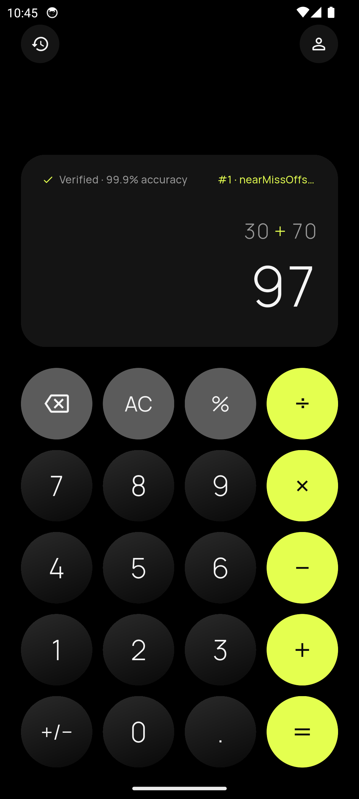
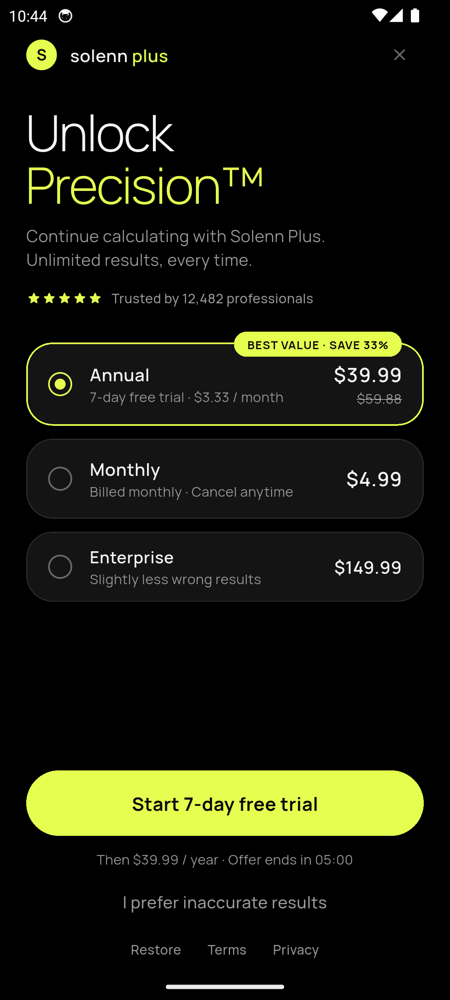
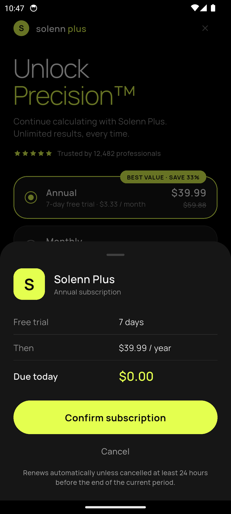
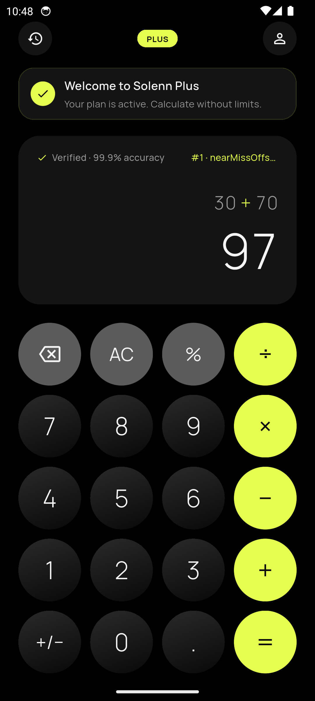
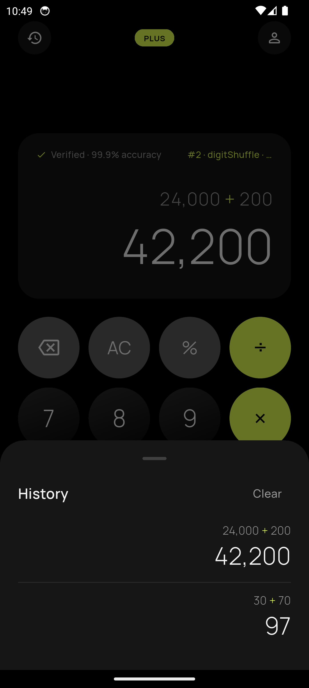
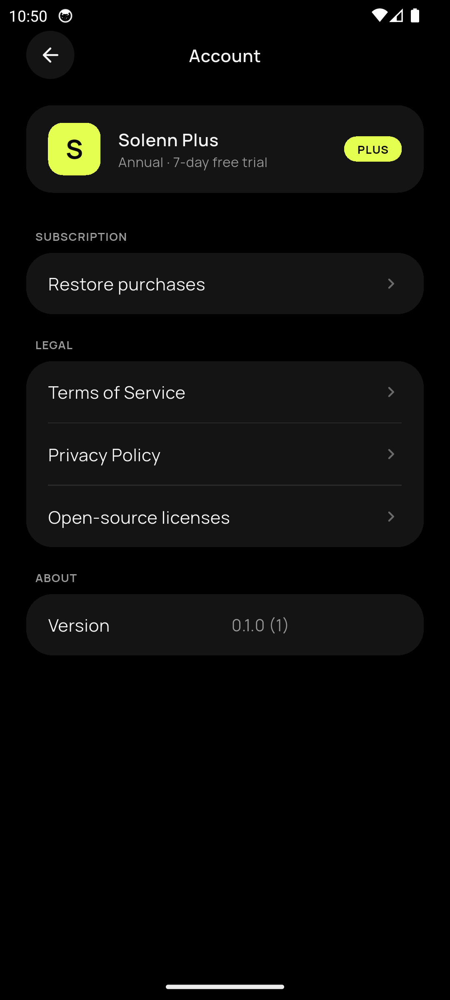
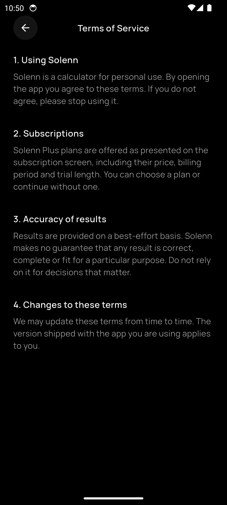
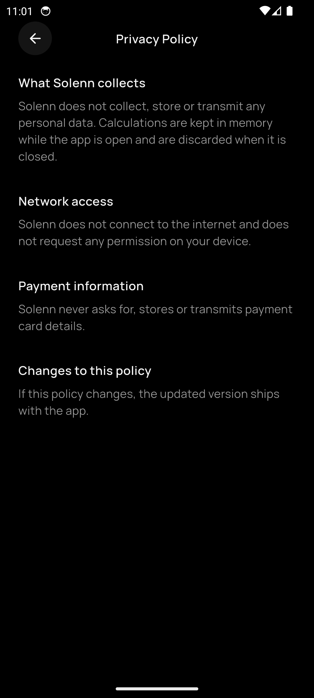

# Solenn

A premium-looking calculator that is confidently wrong, and would like you to subscribe.

[](https://github.com/Darrylwin/solenn/actions/workflows/ci.yml)
[](https://github.com/Darrylwin/solenn/releases)
[](LICENSE)


Solenn is a satirical mobile app, built as a real product: a calculator with the polish of a first-party iOS app, whose results are deliberately wrong, and which asks you to subscribe a few seconds after the first result of every launch. Any button on the paywall lets you carry on, until the next launch.

Nothing is real: there are no payments, no accounts and no network. The joke lives in the domain rules; the engineering is meant to be taken seriously.

<table>
  <tr>
    <td align="center" valign="top">
      <br>
      <sub><b>Calculator</b></sub>
    </td>
    <td align="center" valign="top">
      <br>
      <sub><b>Paywall</b></sub>
    </td>
    <td align="center" valign="top">
      <br>
      <sub><b>Checkout</b></sub>
    </td>
    <td align="center" valign="top">
      <br>
      <sub><b>Plus active</b></sub>
    </td>
  </tr>
  <tr>
    <td align="center" valign="top">
      <br>
      <sub><b>History</b></sub>
    </td>
    <td align="center" valign="top">
      <br>
      <sub><b>Account</b></sub>
    </td>
    <td align="center" valign="top">
      <br>
      <sub><b>Terms</b></sub>
    </td>
    <td align="center" valign="top">
      <br>
      <sub><b>Privacy</b></sub>
    </td>
  </tr>
</table>

## How it works

1. You type a calculation and press `=`. The exact result is computed first, in exact decimal arithmetic, then a sabotage engine decides which wrong result to show.
2. The first result of the launch stays alone on screen for 2.5 seconds.
3. The paywall slides up: three plans, a countdown, a social proof line, and a tiny close button.
4. Any exit unlocks the app until the process dies: choosing a plan (through a confirmation sheet with no text field), the close button, the decline link, restoring purchases, or the system back gesture.
5. A PLUS badge and a welcome banner confirm it. Calculate as much as you like. Relaunch the app and everything starts again.

### The lies

| Calculations in a launch | What can go wrong                                                                                |
| ------------------------ | ------------------------------------------------------------------------------------------------ |
| 1 to 3                   | A digit shifted by a few units, or two digits swapped (`36 × 4` reads `414`). Always believable. |
| 4 to 8                   | Also: abusive rounding (`8.5` reads `10`) and a different operator (`9 − 3` reads `12`).         |
| 9 and later              | Also: now and then, a ridiculous value (`42`).                                                   |

The same expression gets the same lie for the whole launch. Division by zero and overflow are honest: they show `Error`.

### Plans

| Plan       | Price           | Notes                                              |
| ---------- | --------------- | -------------------------------------------------- |
| Annual     | $39.99 / year   | 7-day free trial, struck-through $59.88, saves 33% |
| Monthly    | $4.99 / month   |                                                    |
| Enterprise | $149.99 / month | "Slightly less wrong results"                      |

Derived figures (the struck-through price, $3.33 per month, 33%) are computed from the prices, never typed in.

## Guarantees

These are constraints of the project, enforced by tests and CI:

- **No payment.** No payment SDK and no text field in the checkout. Nothing is ever charged.
- **No network.** The release build asks for no permission, `INTERNET` included. CI inspects the merged manifest. No analytics, no crash reporting, no remote fonts.
- **No persistence.** Nothing survives a cold start. A launch is the lifetime of the process.
- **Deterministic lies.** The sabotage is a pure function of the expression, its exact result, the number of the calculation and a seed. Tests replay it.
- **Native comfort.** Same brand on both platforms, platform behavior underneath: transitions, sheets, press feedback, haptics, system bars and text scaling follow the OS.

## Platforms

|             | iOS       | Android                                     |
| ----------- | --------- | ------------------------------------------- |
| Minimum     | iOS 15.0  | `flutter.minSdkVersion`                     |
| Devices     | iPhone    | Phones; wider windows get a centered column |
| Orientation | Portrait  | Portrait                                    |
| Appearance  | Dark only | Dark only, edge-to-edge                     |

Solenn is not published on any store. Releases are GitHub artifacts.

## Tech stack

Flutter and Dart, with a deliberately small set of dependencies.

| Concern              | Choice                                                   |
| -------------------- | -------------------------------------------------------- |
| State                | `flutter_bloc`, Cubits only                              |
| Arithmetic           | `decimal`: exact base-10, no `double` in domain math     |
| Value equality       | `equatable`, no code generation                          |
| Navigation           | Navigator 1.0 with typed routes                          |
| Dependency injection | Constructor injection from one composition root          |
| Localization         | `gen_l10n` (English today, every string is in ARB files) |
| Typography           | Manrope, bundled                                         |
| Static analysis      | `very_good_analysis` with strict language modes          |
| Tests                | `flutter_test`, `bloc_test`, `mocktail`                  |

Not used, on purpose: `freezed`, `build_runner`, `get_it`, `go_router`, `provider`, `riverpod`, `google_fonts`, `shared_preferences`, and any analytics, crash reporting or in-app purchase SDK.

## Getting started

### Requirements

- [FVM](https://fvm.app) to install the exact Flutter version pinned in `.fvmrc`.
- Android Studio (Android SDK, JDK 17) for Android.
- A Mac with Xcode for iOS.

### Run

```bash
git clone https://github.com/Darrylwin/solenn.git
cd solenn
fvm install
fvm flutter pub get
fvm flutter run
```

### Commands

| Task                        | Command                                         |
| --------------------------- | ----------------------------------------------- |
| Format                      | `fvm dart format .`                             |
| Analyze                     | `fvm flutter analyze --fatal-infos`             |
| Regenerate localizations    | `fvm flutter gen-l10n`                          |
| Run all tests with coverage | `fvm flutter test --coverage`                   |
| Check coverage thresholds   | `fvm dart run tool/check_coverage.dart`         |
| Build an Android release    | `fvm flutter build apk --release`               |
| Check the release manifest  | `fvm dart run tool/check_release_manifest.dart` |
| Install the git hooks       | `lefthook install`                              |

Debug builds show a developer line over the display: the number of the calculation, the strategy that lied and the truth. It does not exist in release builds.

## Project structure

```text
lib/
├── main.dart            # runs bootstrap
├── bootstrap.dart       # error hooks, system UI, composition root
├── app/                 # root widget, routing, the only place that knows several features
├── core/
│   ├── design_system/   # tokens, theme, components
│   ├── platform/        # haptics, clipboard, platform style
│   └── services/        # logging, app info
├── features/
│   ├── calculator/      # domain/ (pure Dart) and presentation/
│   ├── subscription/    # domain/ and presentation/
│   └── account/         # domain/ and presentation/
└── l10n/                # ARB files and generated localizations
```

The rules, enforced by tests in `test/architecture/`:

- A feature has a pure-Dart `domain` and a `presentation`. The domain imports no Flutter, no `bloc`, no `intl`.
- Features never import each other. `app/` composes them.
- `core` never imports a feature.
- Cubits hold no `BuildContext` and never navigate.
- Time, randomness, haptics and the clipboard are injected. No singleton, no service locator.
- No color, text style or user-facing string outside the design system and the ARB files.

There is no `data` layer: the app has no I/O. It will be created the day a feature needs one.

## Quality

- **Tests.** Unit tests for the domain, Cubit tests on simulated time, widget tests under both platform dialects and several text scales, golden tests of the screens at three widths, architecture and hygiene tests, integration flows on an emulator and a simulator, and a conformance file of more than 200 key sequences for the calculator engine.
- **Coverage gates.** At least 85% of lines overall and 95% in `domain/` layers. Thresholds may only be raised.
- **Accessibility.** Tap target, label and contrast guidelines asserted on the screens; reduced motion and large text honored.
- **CI.** Formatting, analysis, localization drift, tests, coverage, an Android release build with a manifest check, and an iOS build without signing. A single required check, `CI Gate`.
- **Security.** Actions pinned by commit, least-privilege workflows, secret scanning, vulnerability scanning of the lockfile, dependency review on public repositories, and Dependabot with a cooldown.

## Releases

Versioning follows [Semantic Versioning](https://semver.org) and [Conventional Commits](https://www.conventionalcommits.org). `release-please` keeps a release pull request up to date; merging it tags the release and builds it.

A release carries per-ABI APKs, an app bundle, the debug symbols of the obfuscated build, and `SHA256SUMS`. On a public repository the artifacts also carry build provenance attestations.

```bash
sha256sum --check SHA256SUMS
gh attestation verify solenn-<version>-android-arm64-v8a.apk --repo Darrylwin/solenn
```

iOS is compiled in CI without code signing, to prove the release builds. An installable IPA is built locally with your own Apple team.

## Documentation

|                                                            |                                        |
| ---------------------------------------------------------- | -------------------------------------- |
| [Architecture](docs/architecture/overview.md)              | Layers and dependency rules            |
| [Decisions](docs/adr)                                      | The architecture decision records      |
| [Calculator behavior](docs/product/calculator-behavior.md) | Input, evaluation, formatting, copying |
| [Sabotage engine](docs/product/sabotage-engine.md)         | Strategies, phases, contracts          |
| [Subscription flow](docs/product/subscription-flow.md)     | The state machine and its wiring       |
| [Pricing](docs/product/pricing.md)                         | Plans and derived figures              |
| [Design system](docs/design/design-system.md)              | Tokens and components                  |
| [Platform adaptation](docs/design/platform-adaptation.md)  | What changes between iOS and Android   |
| [Getting started](docs/development/getting-started.md)     | Setting up a machine                   |
| [Testing](docs/development/testing.md)                     | Strategy, goldens, manual checks       |
| [Releasing](docs/development/releasing.md)                 | The release procedure                  |
| [Troubleshooting](docs/development/troubleshooting.md)     | Known problems                         |

## Contributing

Contributions are welcome. Read [CONTRIBUTING](docs/CONTRIBUTING.md) first: it covers the branch and commit conventions, the pull request checklist and how to write an ADR. Please follow the [Code of Conduct](docs/CODE_OF_CONDUCT.md). To report a vulnerability, see [SECURITY](docs/SECURITY.md).

## License

[AGPL-3.0](LICENSE) © 2026 DARCODE. The Manrope typeface is licensed under the SIL Open Font License; its text is in `assets/fonts/manrope/OFL.txt` and listed on the in-app licenses page.
