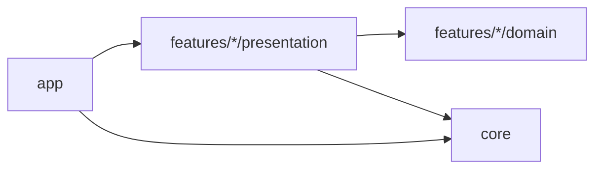

# Architecture overview

Solenn is organized feature-first. Each feature has a pure-Dart `domain` layer
and a `presentation` layer; the shared kernel lives in `core`, and `app`
composes the features. There is intentionally no data layer: the app has no I/O
(see [ADR 0005](../adr/0005-no-persistence-and-no-network.md)). One is created
only when a feature needs it, with its own ADR.

The import rules are in [dependency-rules.md](dependency-rules.md).

## Presentation conventions

- Page / View split: `XPage` creates and provides the Cubits, `XView` is a
  stateless consumer. Tests pump the View with a mocked Cubit.
- Widgets receive data through constructor parameters and contain no business
  logic.
- Rebuild scope is explicit: `BlocSelector` or `buildWhen` on anything fed by a
  high-frequency Cubit. The keypad MUST NOT rebuild when the display changes.
- Public widgets are `const`-constructible where possible. Private helper
  widgets are classes, never builder methods.

## Cubits

| Cubit               | Feature      | Responsibility                                                                                                                     |
| ------------------- | ------------ | ---------------------------------------------------------------------------------------------------------------------------------- |
| `CalculatorCubit`   | calculator   | Applies key presses through the pure input reducer. On `=`, evaluates, sabotages, appends to history, increments `committedCount`. |
| `SubscriptionCubit` | subscription | The paywall state machine. Knows nothing about the calculator.                                                                     |

The two are linked in `app/`: a `BlocListener<CalculatorCubit, CalculatorState>`
with `listenWhen` on `committedCount` increasing calls
`SubscriptionCubit.calculationCommitted()`. Features stay decoupled and no event
bus is needed.

## Composition root

`bootstrap()` builds an immutable `AppDependencies` object (randomness source
seeded per launch, `HapticsService`, `AppInfo`, `PricingCatalog`,
`SabotageEngine`). `SolennApp` receives it as a constructor argument and exposes
services with `RepositoryProvider.value`. Tests construct `SolennApp` with
fakes. There is no global state to reset between tests.

## Error handling and observability

- `bootstrap` installs `FlutterError.onError` and
  `PlatformDispatcher.instance.onError`. Both log through a thin `AppLogger`
  over `dart:developer`.
- Release builds replace `ErrorWidget.builder` with a branded, non-technical
  fallback. Debug builds keep the red screen.
- A `BlocObserver` logs transitions in debug only.
- No remote crash reporting. Debuggability in release comes from
  `--split-debug-info` symbols archived with each release.

## Performance budgets

- 60 fps minimum, 120 fps on capable displays, verified in profile mode before
  each release.
- Cold start to first interactive frame under 1 s on a mid-range device.
- Arm64 release APK under 25 MB, checked in the release workflow.
- The display subtree is wrapped in a `RepaintBoundary`; the keypad is built
  once.
