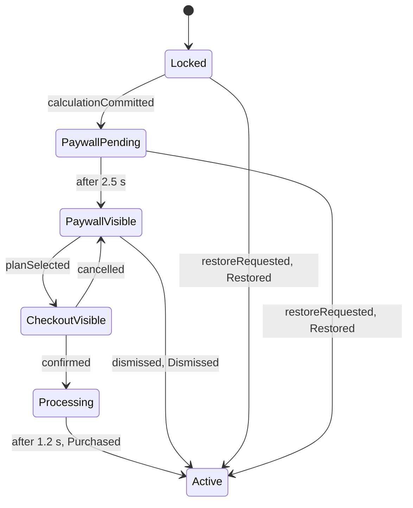

# Subscription flow, navigation and screens

## State machine

| Rule | Statement                                                                                                                                                                        |
| ---- | -------------------------------------------------------------------------------------------------------------------------------------------------------------------------------- |
| F1   | Only the first successful commit of a launch schedules the paywall. Later commits are ignored in every state.                                                                    |
| F2   | The delay is `SubscriptionTimings.paywallDelay` (2500 ms). The result stays fully visible during it.                                                                             |
| F3   | Every exit from the paywall leads to `Active`: close button, decline link, system back, swipe, restore. `DismissReason` is `closeButton`, `declined`, `systemBack` or `restore`. |
| F4   | `Active` is terminal for the launch. It is never persisted.                                                                                                                      |
| F5   | Timers are cancelable and cancelled in `close()`. Time comes from the injected clock; tests use `fakeAsync`.                                                                     |
| F6   | If the app is backgrounded while the delay elapses, the state advances anyway and the presenter shows the paywall on resume.                                                     |
| F7   | On entering `Active`, a welcome banner shows for 4 s and a PLUS badge stays in the header.                                                                                       |

Only one paywall variant ships in 1.0. Variant infrastructure MUST NOT be built
before a second variant exists.

## Paywall details

- The countdown (`Offer ends in 04:59`) is decorative: it starts at 05:00 when
  the paywall appears, restarts at zero, and never blocks anything. It is driven
  by an injected clock inside a small stateful widget.
- The close button is visible immediately, low-contrast but at least 3:1, with a
  44 x 44 target. A delayed or hidden close would fail accessibility and is not
  allowed.
- Footer links: Restore, Terms, Privacy. Restore moves to `Active(Restored)`.
- The checkout sheet shows plan, trial, price and Due today, with Confirm
  subscription and Cancel. No input fields.
- Confirm triggers a haptic, a 1.2 s loading state on the button, then dismissal
  and the welcome banner.

Prices and CTA copy are in [pricing.md](pricing.md).

## Routes

| Route            | Screen               | Presentation                                                                                                             |
| ---------------- | -------------------- | ------------------------------------------------------------------------------------------------------------------------ |
| `/`              | Home (calculator)    | Root                                                                                                                     |
| `/paywall`       | Paywall              | Full-screen modal, slides up. System back is a dismissal (F3), implemented with `PopScope` and routed through the Cubit. |
| `/checkout`      | Checkout             | Adaptive sheet over the paywall                                                                                          |
| `/history`       | History              | Adaptive sheet                                                                                                           |
| `/account`       | Account              | Platform page route                                                                                                      |
| `/account/legal` | Terms or Privacy     | Platform page route, argument `LegalDocumentKind`                                                                        |
| `licenses`       | Open-source licenses | `showLicensePage`, themed                                                                                                |

A typed `AppRoute` layer with `onGenerateRoute` owns names and arguments. Raw
route strings never appear in widgets.

## PaywallPresenter

Lives in `app/`. It listens to `SubscriptionCubit` through the root navigator
key: `PaywallVisible` pushes the paywall (idempotent), `CheckoutVisible`
presents the checkout sheet, `Active` pops back to home. It is tested with a fake
`NavigatorObserver`.

## Composition of Home

`HomeScreen` (in `app/`) builds `CalculatorPage` and passes slots: `headerCenter`
receives the PLUS badge and `banner` the welcome banner, both from the
subscription feature. The calculator therefore never imports subscription code.

## Account screen

Rows: Plan (Free or Plus with plan name), Restore purchases, Terms, Privacy
Policy, Open-source licenses, Version and build. Restore purchases moves to
`Active(Restored)` and confirms with a platform-appropriate message. Legal text
is bundled (`assets/legal`) and parsed by a pure `LegalDocumentParser`
(convention: `#` for headings, blank line between paragraphs). The privacy text
must be truthful: Solenn collects and transmits nothing.

## Domain types

`features/subscription/domain/flow` holds the vocabulary of the state machine.

- **`UnlockSource`** says why the app is unlocked: `Purchased(plan)` after the
  checkout, `Dismissed(reason)` after any exit from the paywall, `Restored`
  after a restoration.
- **`DismissReason`** is `closeButton`, `declined` or `systemBack`.
  Restoration is *not* a dismissal reason: it has its own source, because it
  can also happen before the paywall ever appeared (from the account screen).
  This refines rule F3, which listed `restore` among the reasons.
- **`SubscriptionTimings`** holds the two delays (2.5 s before the paywall,
  1.2 s of fake processing). They are injected so that tests and integration
  runs can shorten them.

## State machine

`SubscriptionCubit` (`features/subscription/presentation/cubit`) implements
the diagram of section 9.1. It refines it in three places.

**Selecting is not buying.** The paywall has a selection and a call to action,
so the plan is first *selected* (`selectPlan`), then bought with the call to
action (`purchase`), which opens the checkout for the selected plan. The
selection survives a cancelled checkout.

**Restoring.** `restore` works from `Locked`, `PaywallPending` and
`PaywallVisible`: the account screen can restore before any calculation, and
the paywall footer can restore while the paywall is up. Restoring while the
paywall is pending cancels the pending paywall.

**Requests, not commands.** Every method is a request. One made in a state
that cannot honor it does nothing and emits nothing.

| State | Honors | Ignores |
|---|---|---|
| `Locked` | `calculationCommitted`, `restore` | everything else |
| `PaywallPending` | `restore` | `calculationCommitted` (no restart), everything else |
| `PaywallVisible` | `selectPlan`, `purchase`, `dismissPaywall`, `restore` | the rest |
| `CheckoutVisible` | `cancelCheckout`, `confirmPurchase` | the rest, `restore` included |
| `Processing` | nothing (the timer ends it) | every request |
| `Active` | nothing | every request: the state is final |

**System back.** On the paywall it is `dismissPaywall(systemBack)`. On the
checkout sheet, closing the sheet (swipe, scrim, back) is `cancelCheckout`,
and during processing the sheet cannot be dismissed. The presenter makes that
mapping; the Cubit only has to ignore what does not apply.

**Time.** Delays come from `SubscriptionTimings` and run on a `Timer` that is
cancelled when the state moves on and when the Cubit closes, so nothing fires
after the flow ended. Tests run on simulated time.

## Assembly

The flow reaches the screen through three pieces in `app/`; `features/*` never
imports another feature.

- **`SolennApp`** creates the `SubscriptionCubit` above the navigator, with the
  catalog and the timings of `AppDependencies`: the flow belongs to the
  launch, not to a screen.
- **`CalculatorPage.onCalculationCommitted`** is the only link between the
  calculator and the flow. The calculator calls it each time a calculation
  succeeds, and `HomeScreen` hands it `SubscriptionCubit.calculationCommitted`.
  The calculator does not know subscriptions exist.
- **`PaywallPresenter`** listens to the flow and navigates, since the Cubit
  must not. `PaywallVisible` pushes the paywall, `CheckoutVisible` opens the
  confirmation sheet over it, going back to `PaywallVisible` closes the sheet,
  and `Active` pops everything above the home screen.
- **`HomeScreen`** fills the slots of the calculator: the PLUS badge as soon
  as the app is unlocked, and the welcome banner for four seconds.

### Closing surfaces

| Gesture | On the paywall | On the checkout sheet |
|---|---|---|
| System back | `dismissPaywall(systemBack)`: unlocks | `cancelCheckout`: back to the paywall |
| Swipe, scrim | none (full screen) | `cancelCheckout` |
| During processing | none | back and scrim are ignored |

During processing a drag can still close the sheet. That does not interrupt
the purchase: the flow unlocks on its own when the delay ends. The paywall is
a page route with its own transition (slide up, or a 120 ms fade when
`disableAnimations` is set), and modal surfaces opened by a presenter are
anonymous routes: `AppRoute` only names destinations reachable by name.

### Wording

Plan names, subtitles, the BEST VALUE badge and the button labels are built
from the catalog and the localized strings (`paywall_content.dart`,
`checkout_content.dart`). A view never contains a price. A plan without
savings shows neither a struck-through price nor a badge, and a plan without
trial offers a plain "Subscribe for" button.

## Account and legal wiring

The account feature stays independent of the subscription one: `AccountView`
renders strings and reports intent. Everything that needs both features lives
in `app/`.

- **`AccountScreen`** (`app/`) builds the screen. It reads the subscription
  state, the catalog and `AppInfo`, and passes plain strings to `AccountView`.
- **`accountPlanFor`** (`app/account_content.dart`) turns the state of the flow
  into the plan card: Solenn Free before the unlock; Solenn Plus with a PLUS
  badge after it. The detail line names the purchased plan (and its trial), or
  says the access is complimentary (paywall dismissed) or restored.
- **Restoring** needs no confirmation of its own: `restore` unlocks the app,
  the presenter pops every screen above home, and the welcome banner confirms.
- **`LegalPage`** (`account/presentation/legal`) loads `assets/legal/<kind>.txt`
  from the asset bundle of the tree and shows it in `LegalView`. Both the
  account screen and the paywall footer open it through `openLegal`.
- **Navigation** goes through `AppRoute` (`/account`, `/account/legal`) and the
  helpers of `app/router/app_navigation.dart`. A legal route needs a
  `LegalDocumentKind` argument, otherwise the router returns `null`.
- **Licenses** use `showLicensePage`, themed by the app theme. The Manrope
  license is registered at bootstrap.
