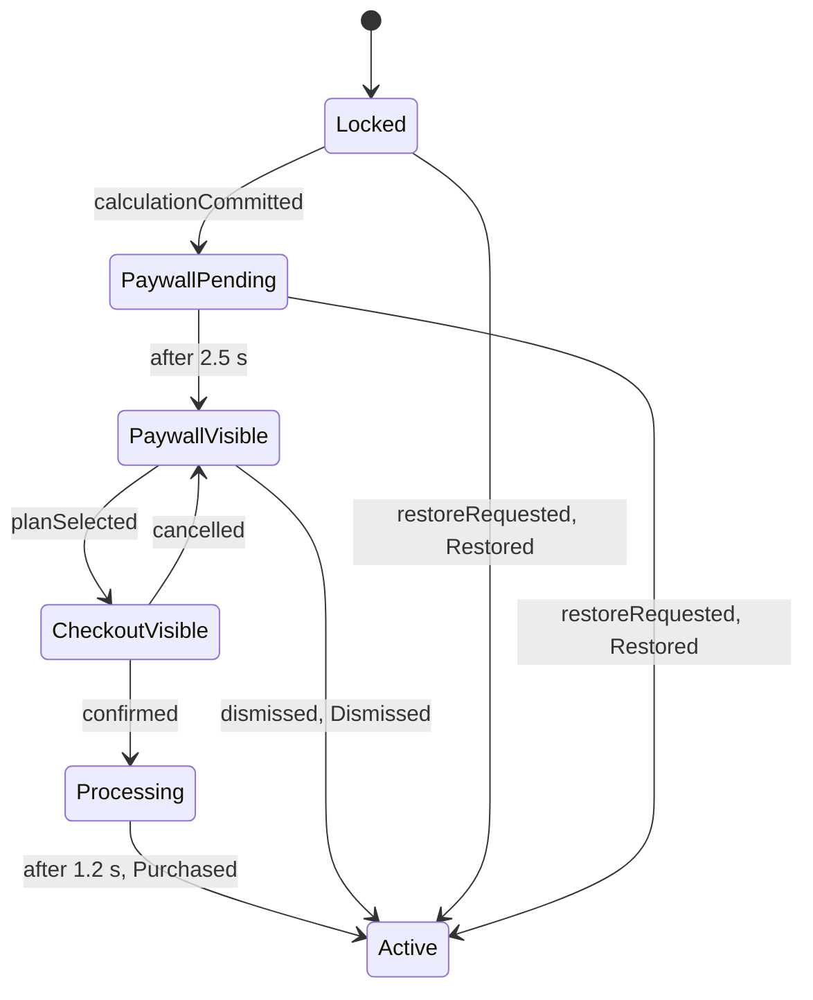

# Subscription flow, navigation and screens

## State machine

| Rule | Statement                                                                                                                                                                        |
| ---- | -------------------------------------------------------------------------------------------------------------------------------------------------------------------------------- |
| F1   | Only the first successful commit of a launch schedules the paywall. Later commits are ignored in every state.                                                                    |
| F2   | The delay is `SubscriptionTimings.paywallDelay` (2500 ms). The result stays fully visible during it.                                                                             |
| F3   | Every exit from the paywall leads to `Active`: close button, decline link, system back, swipe, restore. `DismissReason` is `closeButton`, `declined`, `systemBack` or `restore`. |
| F4   | `Active` is terminal for the launch. It is never persisted.                                                                                                                      |
| F5   | Timers are cancelable and cancelled in `close()`. Time comes from the injected clock; tests use `fakeAsync`.                                                                     |
| F6   | If the app is backgrounded while the delay elapses, the state advances anyway and the presenter shows the paywall on resume.                                                     |
| F7   | On entering `Active`, a welcome banner shows for 4 s and a PLUS badge stays in the header.                                                                                       |

Only one paywall variant ships in 1.0. Variant infrastructure MUST NOT be built
before a second variant exists.

## Paywall details

- The countdown (`Offer ends in 04:59`) is decorative: it starts at 05:00 when
  the paywall appears, restarts at zero, and never blocks anything. It is driven
  by an injected clock inside a small stateful widget.
- The close button is visible immediately, low-contrast but at least 3:1, with a
  44 x 44 target. A delayed or hidden close would fail accessibility and is not
  allowed.
- Footer links: Restore, Terms, Privacy. Restore moves to `Active(Restored)`.
- The checkout sheet shows plan, trial, price and Due today, with Confirm
  subscription and Cancel. No input fields.
- Confirm triggers a haptic, a 1.2 s loading state on the button, then dismissal
  and the welcome banner.

Prices and CTA copy are in [pricing.md](pricing.md).

## Routes

| Route            | Screen               | Presentation                                                                                                             |
| ---------------- | -------------------- | ------------------------------------------------------------------------------------------------------------------------ |
| `/`              | Home (calculator)    | Root                                                                                                                     |
| `/paywall`       | Paywall              | Full-screen modal, slides up. System back is a dismissal (F3), implemented with `PopScope` and routed through the Cubit. |
| `/checkout`      | Checkout             | Adaptive sheet over the paywall                                                                                          |
| `/history`       | History              | Adaptive sheet                                                                                                           |
| `/account`       | Account              | Platform page route                                                                                                      |
| `/account/legal` | Terms or Privacy     | Platform page route, argument `LegalDocumentKind`                                                                        |
| `licenses`       | Open-source licenses | `showLicensePage`, themed                                                                                                |

A typed `AppRoute` layer with `onGenerateRoute` owns names and arguments. Raw
route strings never appear in widgets.

## PaywallPresenter

Lives in `app/`. It listens to `SubscriptionCubit` through the root navigator
key: `PaywallVisible` pushes the paywall (idempotent), `CheckoutVisible`
presents the checkout sheet, `Active` pops back to home. It is tested with a fake
`NavigatorObserver`.

## Composition of Home

`HomeScreen` (in `app/`) builds `CalculatorPage` and passes slots: `headerCenter`
receives the PLUS badge and `banner` the welcome banner, both from the
subscription feature. The calculator therefore never imports subscription code.

## Account screen

Rows: Plan (Free or Plus with plan name), Restore purchases, Terms, Privacy
Policy, Open-source licenses, Version and build. Restore purchases moves to
`Active(Restored)` and confirms with a platform-appropriate message. Legal text
is bundled (`assets/legal`) and parsed by a pure `LegalDocumentParser`
(convention: `#` for headings, blank line between paragraphs). The privacy text
must be truthful: Solenn collects and transmits nothing.
